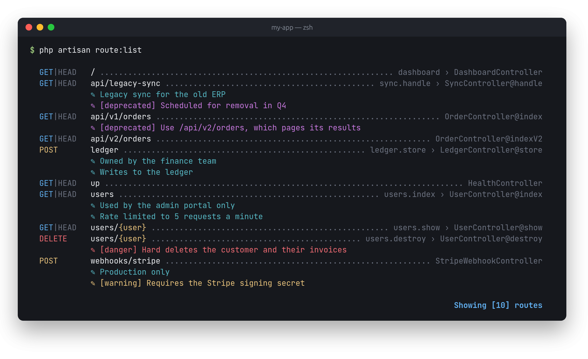
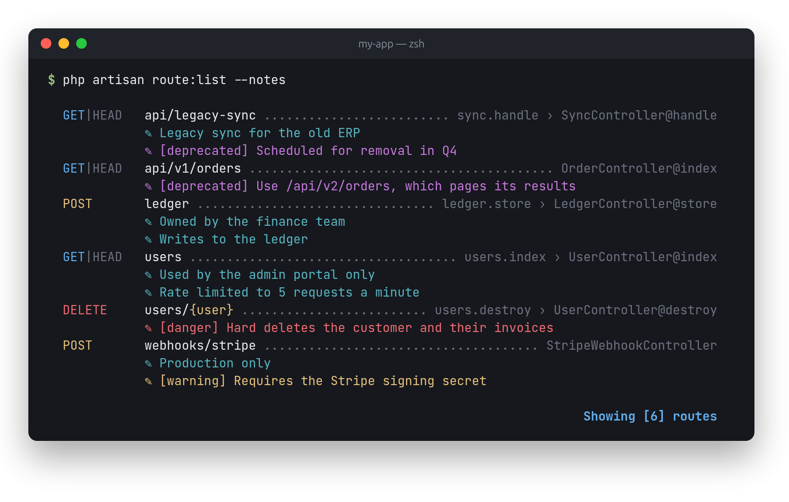
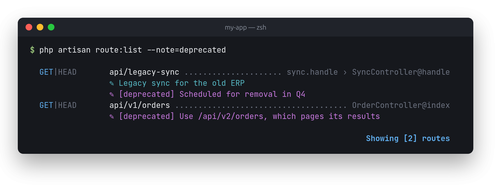
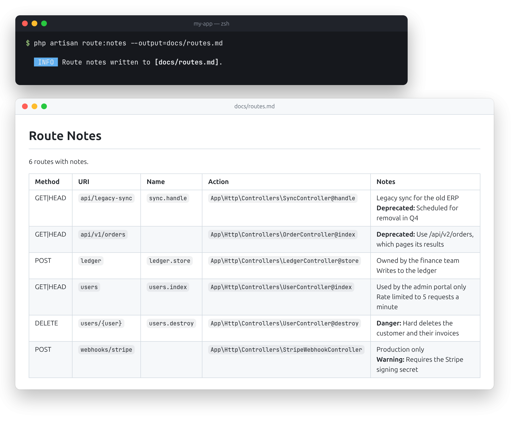

<h1 align="center">📝 Route Notes</h1>

<p align="center">
    <strong>Sticky notes for your Laravel routes, right in <code>php artisan route:list</code>.</strong><br>
    Laravel shows what a route does. Route Notes shows why it's there: who owns it, what's fragile,<br>
    and what's safe to delete.
</p>

<p align="center">
    <a href="https://github.com/Jarryd-W-Hoffman/route-notes/actions/workflows/tests.yml"></a>
    
    
    
</p>

<p align="center">
    
</p>

<p align="center">
    <a href="#why-route-notes">Why Route Notes?</a> ·
    <a href="#features">Features</a> ·
    <a href="#where-notes-come-from">Where notes come from</a> ·
    <a href="#command-reference">Command reference</a> ·
    <a href="#installation">Installation</a> ·
    <a href="#how-it-works">How it works</a> ·
    <a href="#development">Development</a> ·
    <a href="#license">License</a>
</p>

---

## Why Route Notes?

Route Notes came out of working on a 10-year-old codebase that had moved through several versions of Laravel. With 5,000+ routes, many of them dead, deprecated or "temporarily" added for a legacy sync, the context lived in Slack threads and ancient Jira tickets, if anywhere.

- **The why, next to the what.** Mark sensitive endpoints, legacy baggage and internal-only tools where everyone already looks: the route list.
- **Close to the code.** Write notes on the route, in a controller's PHPDoc, or as a `#[Note]` attribute. They move with the code and show up in code review.
- **Nothing changes at runtime.** Notes are metadata. They never reach your controllers or route parameters, and they survive `route:cache`.
- **Laravel's own output.** `route:list` looks and works as it always has, including `-v`, `--json` and every filter. Notes are added beneath each route.

## Features

### ✍️ Writing notes

- **On the route:** chain `note()`, or pass several to `notes()`:

  ```php
  Route::get('/api/legacy-sync', [SyncController::class, 'handle'])
      ->name('sync.handle')
      ->note('Legacy sync for the old ERP')
      ->note('Scheduled for removal in Q4', 'deprecated');

  Route::post('/webhooks/stripe', StripeWebhookController::class)
      ->notes(['Production only', 'Requires the Stripe signing secret']);
  ```

- **Levels:** every note has one, shown in its own color:

  | Level | Use it for | Color |
  | --- | --- | --- |
  | `info` | context, owners, quirks (the default) | cyan |
  | `warning` | things to be careful with | yellow |
  | `deprecated` | routes on their way out | magenta |
  | `danger` | destructive or sensitive endpoints | red |

  Pass the level's name or the `NoteLevel` enum: `->note('Hard deletes customer data', NoteLevel::Danger)`. An unknown level throws an `InvalidArgumentException`, so typos don't slip through.

### 🏷️ In your controllers

- **PHPDoc:** add `@note` tags to a controller method. A note can wrap over several lines, until a blank line or another tag. Start it with `[level]` to set its level.

  ```php
  class OrderController extends Controller
  {
      /**
       * @note Used by the admin portal only
       * @note [deprecated] Use /api/v2/orders, which pages its results
       *       instead of loading every order at once.
       */
      public function index() { ... }
  }
  ```

- **Attributes:** prefer attributes? `#[Note]` can be repeated, and takes a level too:

  ```php
  use Jarryd\RouteNotes\Note;
  use Jarryd\RouteNotes\NoteLevel;

  class UserController extends Controller
  {
      #[Note('Hard deletes the customer and their invoices', level: NoteLevel::Danger)]
      public function destroy(User $user) { ... }
  }
  ```

- **Whole controllers:** notes on the class, in PHPDoc or as attributes, apply to every route using that controller:

  ```php
  /**
   * @note Owned by the finance team
   */
  class LedgerController extends Controller { ... }
  ```

- **Invokable controllers** work the same way: notes on `__invoke` and on the class are both read.

### 🔎 Finding

- **Only routes with notes:** `php artisan route:list --notes` hides the noise when auditing a big route file.
- **Search notes:** `--note=legacy` shows routes with a note containing "legacy" (case-insensitive). Pass a level, like `--note=deprecated`, to list every route with a note of that level.
- **With Laravel's filters:** both combine with `--path`, `--name`, `--method`, `--except-vendor` and the rest, and with `--json`.

<p align="center">
    
    
</p>

### 📤 Sharing

- **Markdown reports:** `php artisan route:notes` writes a Markdown table of every route with notes, ready for a wiki page, a PR description or an audit. Write it to a file with `--output`, and narrow it with the same filters as `route:list`:

  ```bash
  php artisan route:notes --note=deprecated --output=docs/deprecated-routes.md
  ```

- **JSON:** `route:list --json` (and `route:notes --json`) gives each route a `note` array:

  ```json
  {
      "method": "GET|HEAD",
      "uri": "api/legacy-sync",
      "note": [
          {"text": "Legacy sync for the old ERP", "level": "info"},
          {"text": "Scheduled for removal in Q4", "level": "deprecated"}
      ]
  }
  ```

<p align="center">
    
</p>

## Where notes come from

A route's notes are gathered from every source, in this order, with duplicates removed:

```text
Route::get(...)->note('…')             1. fluent notes, in the order they were added
        │
        ▼
class LedgerController                 2. class notes: PHPDoc @note, then #[Note]
        │
        ▼
public function store()                3. method notes: PHPDoc @note, then #[Note]
```

Class notes come from the controller the route points at, even when the method is inherited from a parent class. Closure routes can only have fluent notes.

## Command reference

`route:list` keeps all of its usual options. Route Notes adds:

| Option | What it does |
| --- | --- |
| `--notes` | Only show routes that have notes |
| `--note=TEXT` | Only show routes with a note containing `TEXT`, or of level `TEXT` |

`route:notes` accepts every `route:list` filter, plus:

| Option | What it does |
| --- | --- |
| `--output=PATH`, `-o` | Write the report to a file instead of the console |
| `--json` | Output JSON instead of Markdown |

## Installation

```bash
composer require jarryd/route-notes
```

That's it: the package registers itself. There's no config to publish and no service provider to add.

| Requirement | Version |
| --- | --- |
| **PHP** | 8.2+ (8.3+ for Laravel 13) |
| **Laravel** | 12.x or 13.x |

## How it works

| Piece | What it does |
| --- | --- |
| `Route::note()` and `notes()` | Macros that store notes in the route's action array, which `route:cache` exports as-is |
| `RouteListCommand` | Replaces Laravel's `route:list` in the container, and adds notes on top of its normal output |
| `RouteNotesCommand` | `route:notes`: the same command, rendering Markdown instead |
| `NoteReader` | Reads `@note` tags and `#[Note]` attributes by reflection, cached per controller |

Notes live in the route **action** rather than the route **defaults**, because Laravel merges defaults into a route's parameters when it's dispatched. Keeping them in the action means your controllers never see them.

PHPDoc and attributes are only read when `route:list` or `route:notes` runs, never while serving requests.

## Development

```bash
composer install
composer test         # PHPUnit
```

| Command | What it does |
| --- | --- |
| `composer test` | Run the unit and feature tests |
| `composer lint` | Check code style with Pint |
| `composer format` | Fix code style with Pint |
| `composer analyse` | PHPStan (level 8) on `src` |
| `composer analyse:tests` | PHPStan on the tests |
| `composer screenshots` | Regenerate the screenshots in this README |

CI runs the tests on PHP 8.2 to 8.5 against Laravel 12 and 13, and lint and static analysis once in their own job.

### Screenshots

The screenshots above are taken of a small demo app (`tests/Screenshots/DemoApp.php`): the real `route:list` and `route:notes` output, captured in color and rendered in a terminal window with headless Chrome. After changing what a screenshot shows, run `composer screenshots` and commit the images it writes to `.github/screenshots`. It needs Chrome (set `CHROME_PATH` if it isn't found), the GD extension, and a network connection for the font.

### Contributing

Pull requests are welcome.
- Work on a feature branch and keep commits small.
- Sign off every commit (`git commit -s`): the repository checks the [Developer Certificate of Origin](https://developercertificate.org).
- Each change comes with tests, and `composer test`, `composer lint` and both `composer analyse` commands should pass before you open a PR.

## License

Route Notes is open-source software licensed under the [MIT license](LICENSE).
